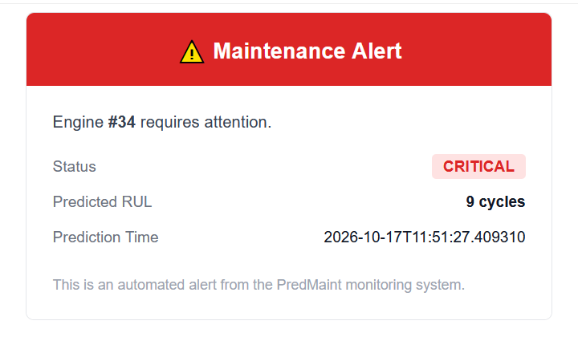
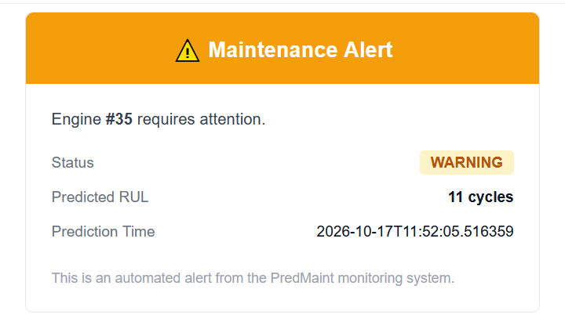

# PMPS — Predictive Maintenance Platform System

End-to-end predictive maintenance pipeline for turbofan jet engines, built on
NASA's C-MAPSS (FD001) dataset. It predicts each engine's **Remaining Useful
Life (RUL)** from sensor readings, stores predictions in PostgreSQL, serves
them through a REST API, and sends **email alerts** automatically through n8n
when an engine needs maintenance.

## Demo

Alert emails sent by the n8n workflow (shown in a Mailtrap sandbox inbox):

<table>
  <tr>
    <td align="center"><b>CRITICAL</b> — engine 34, predicted RUL 9 cycles</td>
    <td align="center"><b>WARNING</b> — engine 35, predicted RUL 11 cycles</td>
  </tr>
  <tr>
    <td></td>
    <td></td>
  </tr>
</table>

## Pipeline

```
Sensor Data → Cleaning / Feature Engineering → XGBoost Model → RUL Prediction
            → PostgreSQL → FastAPI → n8n Automation → Maintenance Alerts (email)
```

Everything runs in Docker (PostgreSQL + API); n8n runs alongside it as a
separate container.

## Dataset

[NASA C-MAPSS (FD001)](https://www.nasa.gov/intelligent-systems-division/discovery-and-systems-health/pcoe/pcoe-data-set-repository/) —
100 training engines and 100 test engines, 1 operating condition, 1 fault
mode (HPC degradation), 21 sensor channels per cycle. The three FD001 files
are included in `data/`.

## Model

XGBoost regressor trained on:

- the selected raw sensor / operating-setting columns, and
- rolling-window features (mean and std over 5 and 10 cycles) for sensors
  4, 7, 11 and 12,

with the training RUL **capped at 125 cycles** (piecewise-linear degradation,
standard practice on this dataset).

Three model versions are kept in `models/`, each built in a notebook and
reproducible with a script in `src/ml/`:

| Version | What changed | File |
|---|---|---|
| v1 | Baseline XGBoost | `models/final_xgboost.json` |
| v2 | + rolling-window features | `models/final_xgboost_v2.json` |
| v3 | + rolling features + RUL cap 125 (**used by the API**) | `models/final_xgboost_v3.json` |

### Results

Evaluated on the untouched FD001 test set (all 100 engines, last cycle of
each) — see `notebooks/05_test_evaluation.ipynb`:

| Model | RMSE | MAE | R² | C-MAPSS score (lower is better) |
|---|---|---|---|---|
| v1 | 25.29 | 18.32 | 0.63 | 5228 |
| v2 | 25.62 | 19.03 | 0.62 | 4741 |
| **v3** | **18.12** | **13.48** | **0.81** | **619** |

The RUL cap (v3) gave the biggest improvement: early in an engine's life the
sensors show no degradation, so predicting an exact large RUL is not possible
and capping the target at 125 removes that noise.

**Limitations:** trained and evaluated on FD001 only (one operating condition,
one fault mode); predicts from the latest cycle's features and rolling
windows, with no uncertainty estimate.

## Maintenance status rules

The API classifies every predicted RUL (in cycles):

| Predicted RUL | Status |
|---|---|
| ≤ 15 | `CRITICAL` |
| ≤ 30 | `WARNING` |
| > 30 | `NORMAL` |

The logic lives in `src/api/services/alerts.py`.

> These thresholds (15 and 30 cycles) are illustrative defaults, not derived
> from the data or from a maintenance-cost analysis. In a real deployment they
> would be tuned to the lead time needed to schedule maintenance.

## Project structure

```
PMPS/
├── Dockerfile                  # Builds the API image
├── docker-compose.yml          # PostgreSQL + API services
├── requirements.txt
├── .env.example                # Copy to .env and set POSTGRES_PASSWORD
├── database/
│   └── schema.sql              # sensor_readings, predictions, simulation_predictions
├── docs/
│   └── images/                 # Demo screenshots of the alert emails
├── data/                       # C-MAPSS FD001 files
├── models/                     # Trained XGBoost models (v1, v2, v3)
├── notebooks/
│   ├── 01_train_eda.ipynb          # Training data exploration
│   ├── 02_test_analysis.ipynb      # Test data analysis
│   ├── 03_baseline_modeling.ipynb  # Baseline models
│   ├── 04_xgboost_tuning.ipynb     # Tuning, rolling features, RUL cap
│   └── 05_test_evaluation.ipynb    # Final test-set evaluation
├── n8n/
│   └── pmps_workflow.json      # Exported n8n alert workflow (import into n8n)
├── tests/
│   └── test_alerts.py          # Unit tests for the status thresholds
├── LICENSE
└── src/
    ├── config.py               # Paths, model features, DB settings
    ├── ml/                     # Preprocessing, training helpers, prediction
    │   ├── preprocessing.py
    │   ├── training.py
    │   ├── predict.py
    │   └── xgboost_v1.py / xgboost_v2.py / xgboost_v3.py
    ├── db/                     # Everything that touches PostgreSQL
    │   ├── load_to_db.py       # Loads sensor data into the database
    │   └── queries.py          # Read/write queries
    ├── api/
    │   ├── main.py             # FastAPI app
    │   ├── routes/             # HTTP layer (predictions, simulations)
    │   └── services/           # Business logic (prediction_service, alerts)
    └── test/
        └── test_simulation_save.py
```

## Setup

### 1. Clone and install dependencies

```bash
git clone https://github.com/Sohilaeldally/PMPS.git
cd PMPS
python -m venv .venv
source .venv/bin/activate        # Windows: .venv\Scripts\activate
pip install -r requirements.txt
```

### 2. Configure the environment

```bash
cp .env.example .env             # Windows: copy .env.example .env
```

Open `.env` and set `POSTGRES_PASSWORD` to a password of your choice.

### 3. Start PostgreSQL and the API

```bash
docker-compose up -d --build
```

| Service | Container | URL / port |
|---|---|---|
| PostgreSQL | `predmaint_postgres` | `localhost:5433` (host) / `postgres:5432` (inside Docker) |
| FastAPI | `predmaint_api` | http://localhost:8000 |

Interactive API docs: http://localhost:8000/docs

### 4. Tables

The tables are created automatically from `database/schema.sql` the first
time the database container starts (empty volume). If you started the
database before this was added, create them once manually:

```bash
docker exec -i predmaint_postgres psql -U predmaint -d predictive_maintenance_db < database/schema.sql
```

On Windows PowerShell use:
`Get-Content database/schema.sql | docker exec -i predmaint_postgres psql -U predmaint -d predictive_maintenance_db`

### 5. Load the sensor data

The loader reads `data/test_FD001.txt` and inserts it into `sensor_readings`.
Run it from the `src/` folder (the database is reachable on `localhost:5433`):

```bash
cd src
python db/load_to_db.py
```

Run this **once** — running it again inserts the rows a second time.

### 6. (Optional) Retrain a model

The trained models are already in `models/`. To retrain, either run the
notebooks in order (`01` → `05`), or run a training script from `src/`:

```bash
cd src
python -m ml.xgboost_v3
```

The API loads `models/final_xgboost_v3.json`.

### Running the API without Docker

```bash
cd src
uvicorn api.main:app --reload
```

This needs PostgreSQL running (`docker-compose up -d postgres`).

## API endpoints

| Method | Endpoint | Description |
|---|---|---|
| GET | `/` | Health check |
| GET | `/predictions/latest` | Latest prediction per engine, with `maintenance_status` |
| GET | `/predictions/history/{engine_id}` | Full prediction history for one engine |
| POST | `/predictions/run-all` | Run and store a new prediction for **every** engine; returns counts per status |
| POST | `/predictions/{engine_id}` | Run and store a new RUL prediction for one engine |
| POST | `/simulations/{engine_id}` | Replay an engine's life cycle by cycle and store every prediction; returns a `simulation_id` |
| GET | `/simulations/{simulation_id}` | Cycle-by-cycle results of a simulation run |

Example:

```bash
curl -X POST http://localhost:8000/predictions/run-all
curl -X POST http://localhost:8000/predictions/1
curl http://localhost:8000/predictions/latest
curl -X POST http://localhost:8000/simulations/1
```

### Simulations

A simulation walks through one engine's history cycle by cycle, predicting
RUL using only the data available up to that cycle. Each run gets its own
`simulation_id` (UUID), so the same engine can be simulated many times
without overwriting earlier runs. Results are stored in
`simulation_predictions` and can be compared against the true RUL.

## n8n alert automation

An n8n workflow turns predictions into email alerts:

```
Schedule Trigger (daily, 9:00)
        ↓
HTTP Request  → POST /predictions/run-all   (refresh predictions)
        ↓
HTTP Request  → GET  /predictions/latest
        ↓
Filter        → keep only CRITICAL and WARNING engines
        ↓
Loop (1 item at a time) → Send Email → Wait 12 s → next engine
```

One email is sent per engine that needs attention, 12 seconds apart, so
email providers with rate limits (e.g. Mailtrap's free sandbox) accept them
all.

The email contains the engine ID, status, predicted RUL and prediction time.


### Set it up

1. Run n8n (locally in Docker, UI at http://localhost:5678).
2. In n8n: **Workflows → Import from file →** `n8n/pmps_workflow.json`.
3. In the HTTP Request node, make sure the URL points to the API as seen
   **from the n8n container**, e.g. `http://host.docker.internal:8000/predictions/latest`.
4. Create an **SMTP credential** and attach it to the *Send Email* node. For
   testing, [Mailtrap](https://mailtrap.io) Email Sandbox works well
   (host `sandbox.smtp.mailtrap.io`, port `2525`, no real emails are sent).
5. Run the workflow.

Credentials are not stored in the exported workflow file; you must create
them in your own n8n instance.

## Tests

```bash
pytest tests
```

Unit tests cover the CRITICAL / WARNING / NORMAL thresholds.

## Tech stack

Python · pandas · scikit-learn · XGBoost · FastAPI · PostgreSQL · psycopg2 ·
Docker / Docker Compose · n8n

## License

MIT — see [LICENSE](LICENSE).

## Author

Sohila Reda — [@Sohilaeldally](https://github.com/Sohilaeldally)
